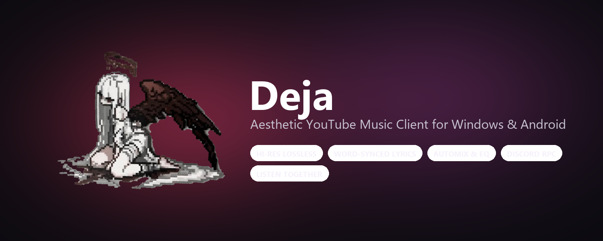

 
 

# Deja

### Aesthetic YouTube Music Client for Windows & Android

 

 

[**Download**](#download) · [**Features**](#features) · [**Website**](https://dathevinci.github.io/Deja/) · [**Contributing**](#contributing) · [**Disclaimer**](#disclaimer)

 

> [!IMPORTANT]
> Deja is not affiliated with, endorsed by, or connected to YouTube or Google in any way. Use it at your own discretion.

---

<h1>Features</h1>

<table>
  <tr>
    <td width="50%" valign="top">

#### Playback
- **Search, browse and play** anything available on YouTube Music.
- **Hi-Res lossless audio** — FLAC/ALAC from a configured module source, with YouTube Music 160k Opus / 256k AAC as fallback.
- **Gapless playback with true crossfade**, adjustable 0–12s.
- **Automix [Beta]** — DJ-style transitions with beat-matching and tempo-stretching.
- **Offline downloads** — save tracks with embedded metadata.
- **Local music library** integration across desktop and Android.
- **Background playback** via system tray / foreground media session.
- **Apple-like lyrics animation** — credit to [binimum](https://github.com/binimum/am-lyrics).

#### Experience
- **Animated album canvas** — motion artwork on the now-playing screen.
- **Word-synced lyrics** — word/syllable-level highlighting from multiple sources (BetterLyrics, SimpMusic, LRCLIB, YouTube, KuGou).
- **Dynamic, artwork-driven theming** — palette extracted from album art.
- **Frosted-glass UI** — translucent Liquid Glass bars and Material 3 / Apple dark theming.

    </td>
    <td width="50%" valign="top">

#### Connectivity & Accounts
- **Sign in with your Google account** for personalized playlists, library, and recommendations.
- **Discord Rich Presence** — live track/artist/album and progress broadcasting.
- **Scrobbling** to Last.fm and ListenBrainz.
- **Listen Together** — real-time synchronized listening party with friends.
- **Pluggable sources** — add, edit, test and health-check module sources.

#### Controls & Tweaks
- **Per-network audio quality** — separate quality ceilings for Wi-Fi/Ethernet and mobile data.
- **Output precision & USB DAC** — configurable 16-bit, 24-bit, or 32-bit Float PCM output and loudness normalization.
- **Playback speed control** (0.5×–2.0×) and **skip silence**.
- **Sleep timer** — fixed presets or "stop after this track".
- **10-Band Equalizer & Spatial Audio** integration.
- **Stats for nerds** — codec, bit depth, sample rate, and buffer health on the now-playing screen.

    </td>
  </tr>
</table>

---

<h1>Download</h1>

Grab the latest **Windows Installer (`Deja.Setup.1.2.2.exe`)**, **Portable (`Deja.1.2.2.exe`)**, or **Android APK (`Deja.apk`)** from the [Releases](https://github.com/Dathevinci/Deja/releases) page or the [Official Website](https://dathevinci.github.io/Deja/).

| Platform | Package | Direct Link |
| :--- | :--- | :--- |
| **Windows (x64)** | NSIS Installer (`.exe`) | [**Download Deja.Setup.1.2.2.exe**](https://github.com/Dathevinci/Deja/releases/download/v1.2.2/Deja.Setup.1.2.2.exe) |
| **Windows (x64)** | Portable Executable (`.exe`) | [**Download Deja.1.2.2.exe**](https://github.com/Dathevinci/Deja/releases/download/v1.2.2/Deja.1.2.2.exe) |
| **Android (8.0+)** | Universal Signed APK (`.apk`) | [**Download Deja.apk**](https://github.com/Dathevinci/Deja/releases/download/v1.2.2/Deja.apk) |

---

<h1>Contributing</h1>

We welcome contributions to Deja! Please review our [Contributing Guide](CONTRIBUTING.md) and [Code of Conduct](CODE_OF_CONDUCT.md) before submitting a Pull Request.

[**Contributing Guide**](CONTRIBUTING.md) · [**Code of Conduct**](CODE_OF_CONDUCT.md) · [**Maintainers**](MAINTAINERS.md) · [**Additional Docs**](ADDITIONAL.md)

---

<h1>Disclaimer & Legal Notice</h1>

Deja is an independent, community-driven third-party audio player and client. It is **not** associated with Google LLC, YouTube Music, Deezer, Telegram, or any of their parent companies.

* **No Media Hosting:** Deja does not host, upload, or store copyrighted music files. It operates strictly as an interface to scan local device storage or stream media directly from public, public-facing, or user-authenticated APIs.
* **Fair Use & API Usage:** This software is created solely for personal research, educational, and fair-use purposes. The user is entirely responsible for ensuring their usage aligns with their local copyright laws and YouTube Terms of Service.
* **No Ad-Blocking Guarantee:** While Deja focuses on providing a clean listening environment, it does not guarantee permanent bypasses or modifications to commercial third-party platform conditions.
* **Copyleft:** Deja is free software under the GPLv3. The license does not let anyone forbid others from selling or redistributing copies, but any distribution must come with the Corresponding Source under the same license.

---

<h1>License</h1>

This project is licensed under the **GNU General Public License v3.0 (GPLv3)**. See the [LICENSE](LICENSE) file for details.

